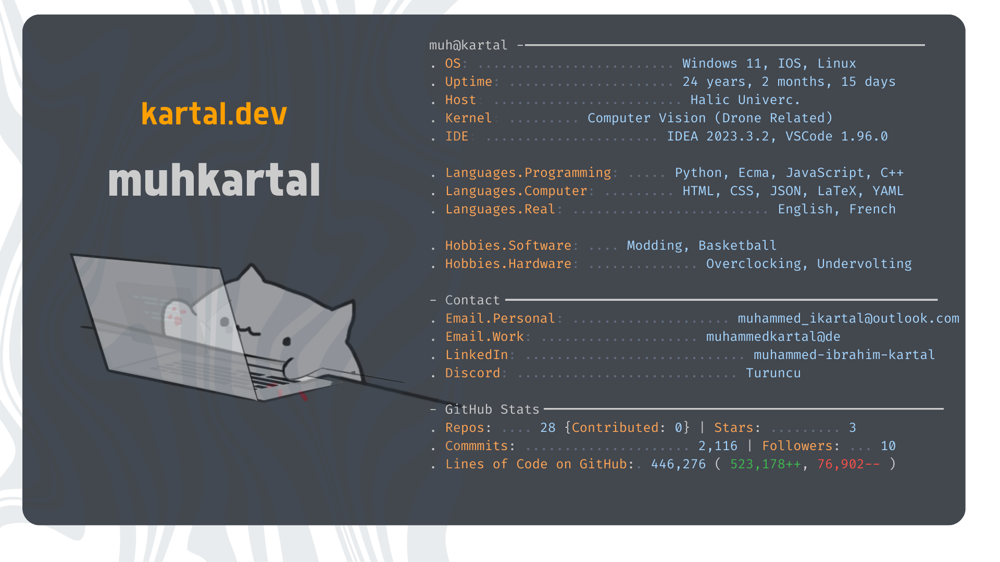
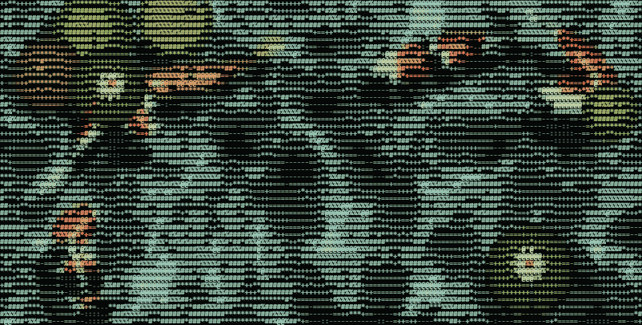

**`Software Engineer`**

Building intelligent systems with Machine Learning and Deep-Learning, with a strong interest in Computer Vision applications. I develop software tools using Python, C#, and JavaScript to improve daily life. My GitHub features projects in ML/DL (TensorFlow, PyTorch), Computer Vision (OpenCV), and various software applications (Streamlit, Flask). Currently learning MLOps, real-time object detection, and scalable AI.

---

  
  鯉の池 · click the pond to stir the water and feed the koi

---

<h2 align="center">⚒️ Languages-Frameworks-Tools ⚒️</h2>

    
     

